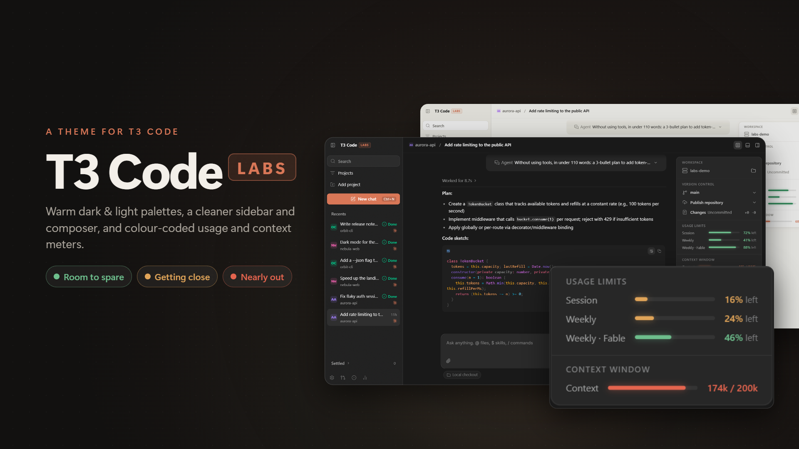
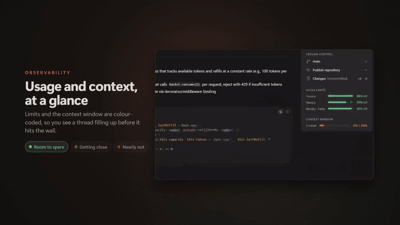
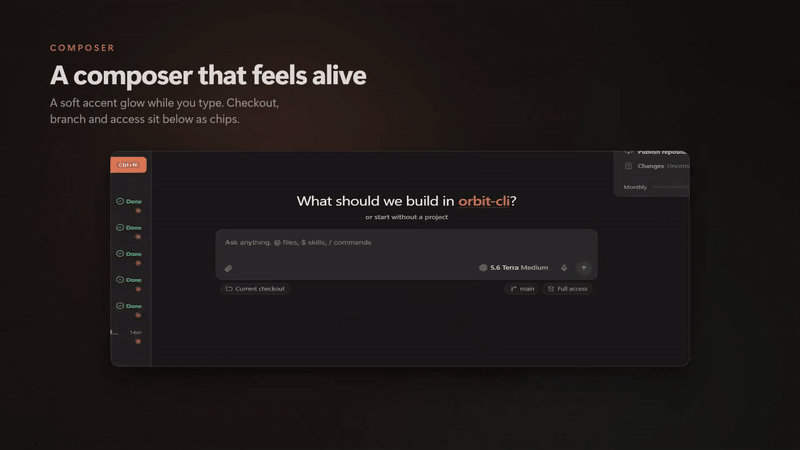
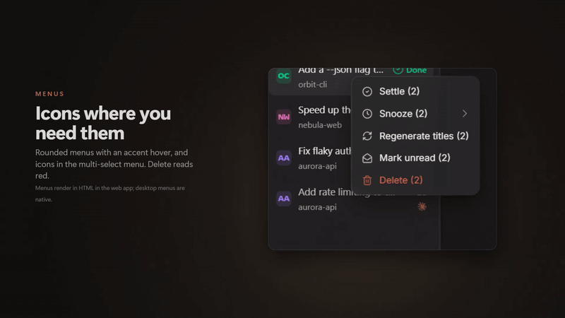
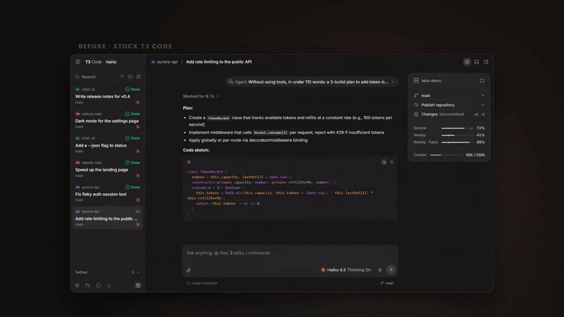
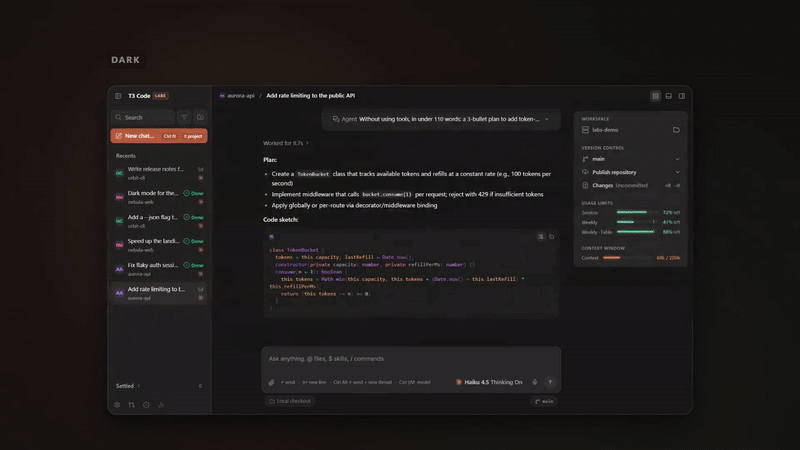
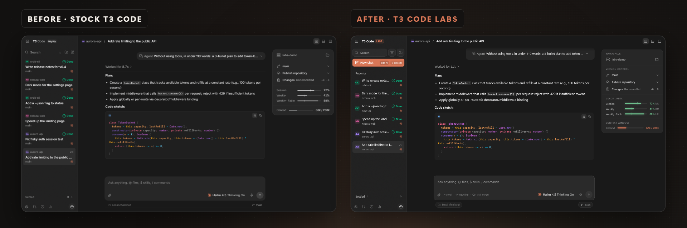
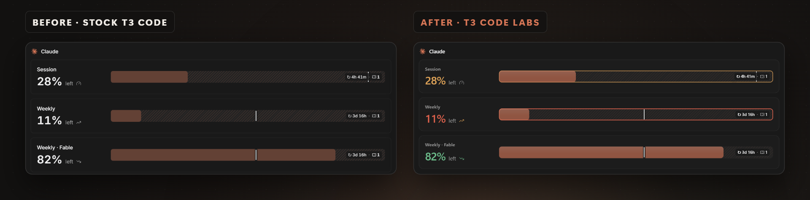
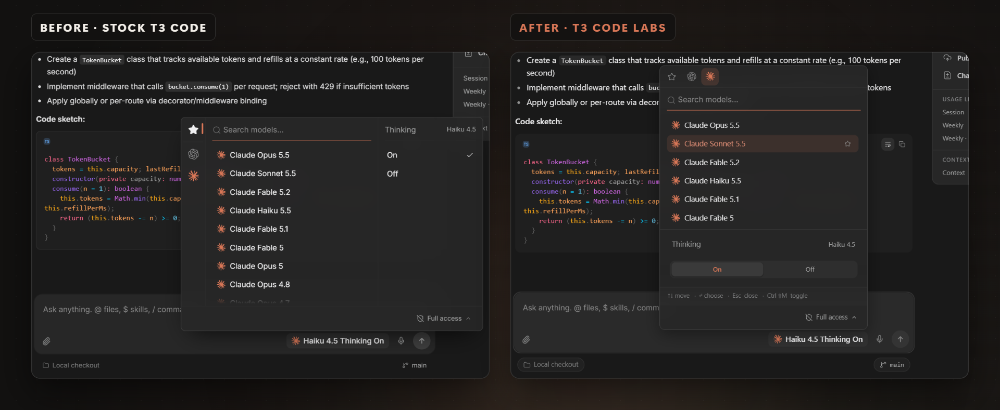

# T3 Code Labs

A premium, observability-first theme for [T3 Code](https://github.com/pingdotgg/t3code). One file, no fork.

[](https://github.com/brunobola-portfolio/t3-code-labs/releases/latest) [](LICENSE) [](https://github.com/pingdotgg/t3code)

[Português](README.pt.md)

[](media/t3-code-labs-film.mp4)

T3 Code Labs keeps the T3 Code name and adds a small **Labs** badge. It restyles the app with warm clay colours, a cleaner sidebar and composer, and colour-coded usage and context meters, so you can see at a glance how much of your limits and context window a thread has used.

## What changes

**Look and feel**
- Warm dark and light palettes with a clay accent.
- "T3 Code" header with a **Labs** badge.
- A compact sidebar header: search, Projects and Add project on one row, then **New chat…** with its shortcuts beside the label. A click or **Ctrl N** opens T3's project picker (Enter picks the current one); **⇧ project** (Shift+click or Ctrl+Shift+N) starts a thread in the current project straight away.
- Command palette and project picker with rounded rows, the highlighted row in the accent, and a tip in the picker on how to skip it.
- The project in the breadcrumb shows a **+** on hover: one click starts a new thread there.
- Two-line thread rows, a "Recents" heading, and tidier Working / Settled shelves.
- A single-column model picker with effort levels as a segmented bar, the active provider and the hovered model in the accent, and a key-hint footer (↑↓ move, ↵ choose, Esc close, Ctrl+Shift+M toggle).
- Rounded, softer context menus with an accent hover. Icons are added to the multi-select menu (Settle, Snooze, Regenerate titles, Mark unread, Delete) when T3 Code renders it in HTML.

**Observability**
- Usage-limit meters in the thread details card are **green** while you have room, **amber** below 35% left and **red** below 15% left.
- The context-window meter turns **amber** at 65% used and **red** at 85%, so you know when a thread is getting full.
- The **Usage → Limits** page (Ctrl+U) gets one card per limit: the number turns green, amber or red, an account bar that runs low gets an amber or red ring (accounts keep their own colours), and the pace hint shows amber when you spend faster than the window and green when you have headroom.
- The composer gets a soft accent glow and key hints while you type (↵ send, ⇧↵ new line, Ctrl+Shift+M model). Its context strip shows as chips: the branch in monospace, and the permission mode in green, or amber when the agent has **Full access**.

## Preview

| Usage & context meters | Composer | Menus (web) |
| --- | --- | --- |
|  |  |  |

| Before → after | Dark ↔ light |
| --- | --- |
|  |  |

**Before and after** (stock T3 Code on the left, T3 Code Labs on the right)



**Usage → Limits** (Ctrl+U), before and after



**Composer and model picker**, before and after



[Watch the launch film](media/t3-code-labs-film.mp4) (48 s, with sound). Every frame of the UI is the real T3 Code web app running on a demo instance, composited from HTML; the music and sound effects are synthesized from scratch in about 200 lines of JavaScript. The [before/after wipe](media/before-after.mp4) is also available as a short clip. All media use demo data, and you can regenerate them with the scripts in [`media/src`](media/src/README.md).

## Install

**With the T3 CLI** (publishes the theme and switches T3 Code to it):

```sh
curl -LO https://github.com/brunobola-portfolio/t3-code-labs/releases/latest/download/t3-code-labs.json
t3 theme set ./t3-code-labs.json
```

**Or by hand:** download [`t3-code-labs.json`](https://github.com/brunobola-portfolio/t3-code-labs/releases/latest/download/t3-code-labs.json) from the [latest release](https://github.com/brunobola-portfolio/t3-code-labs/releases/latest). In T3 Code, open **Settings → Appearance → Add theme**, drop the file in (or paste it into **Theme JSON**), then pick **T3 Code Labs**.

Dark and light modes are both included.

### Recommended settings

The theme styles information T3 Code already has, but some of it is off by default. Turn it on to get the full dashboard:

1. **Settings → Appearance → Thread details**: enable **Usage limits** and **Context window**.
2. **Settings → Appearance → Advanced → Composer context**: on. This keeps the branch and worktree visible below the composer after a thread starts.

For cost per model, tokens and cache savings, open T3 Code's built-in usage page with **Ctrl+U**.

## Requirements and notes

- Needs a T3 Code build whose themes accept `css`. It was tested on Nightly `0.1.10-nightly.20261116`; older nightlies import the colours only.
- On the desktop app, right-click menus are native OS menus, which themes cannot style. The menu icons show up when T3 Code runs in the browser. Everything else (sidebar, composer, model picker, meters, Usage page) looks the same on desktop and web.
- The key hints show T3 Code's default shortcuts (Windows and Linux labels). If you remapped them, the hints do not know.
- T3 Code styles can change between releases. The theme uses T3's stable selectors where it can; if something looks off after an update, [open an issue](https://github.com/brunobola-portfolio/t3-code-labs/issues).

## Build from source

`t3-code-labs.json` is generated. Edit `scripts/build.py` (or `src/base.json`), then run:

```sh
python scripts/build.py
```

## Support

If T3 Code Labs makes your day a little nicer, you can [buy me a coffee on Ko-fi](https://ko-fi.com/brunobola) or [Buy Me a Coffee](https://buymeacoffee.com/brunobola). Stars and issues help too.

## Credits

Built on [T3 Clawd](https://github.com/rohit3a/t3-clawd) by [@rohit3a](https://github.com/rohit3a) (MIT), whose layout work is the base of this theme.

Unofficial. Not affiliated with T3 Tools Inc. T3 Code is a product of T3 Tools Inc.

## License

[MIT](LICENSE). Made by [BolaLabs](https://github.com/BolaLabs).
