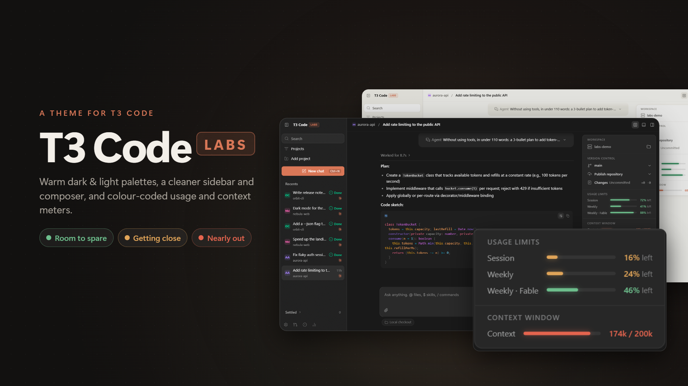
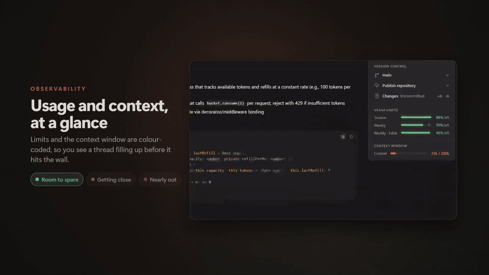
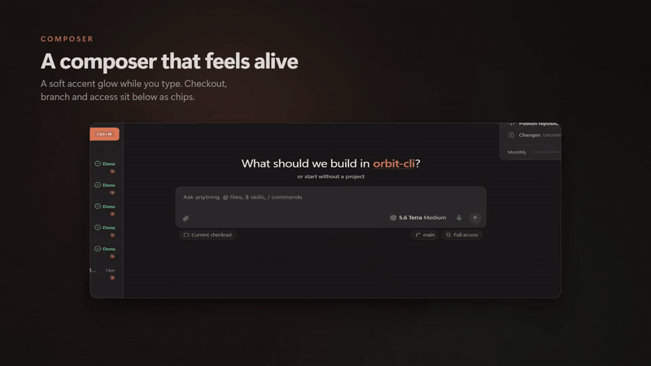
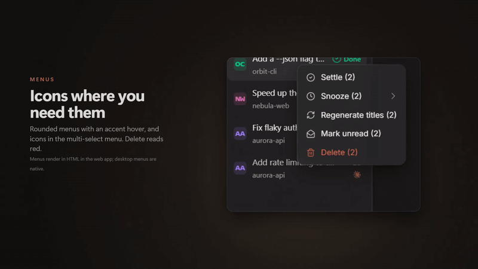
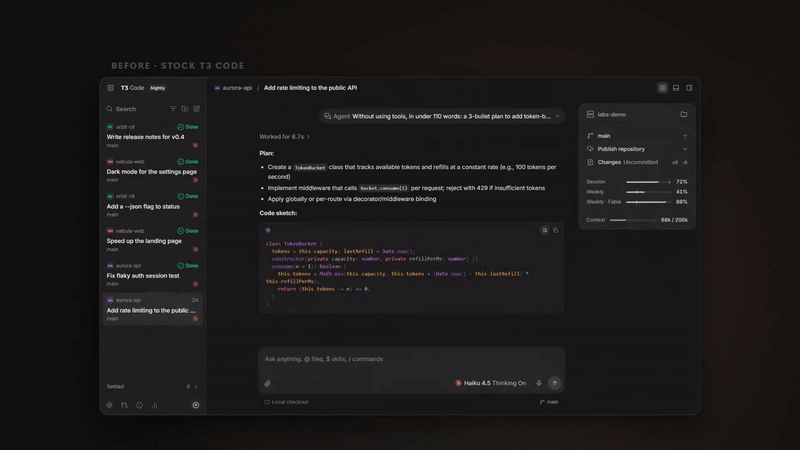
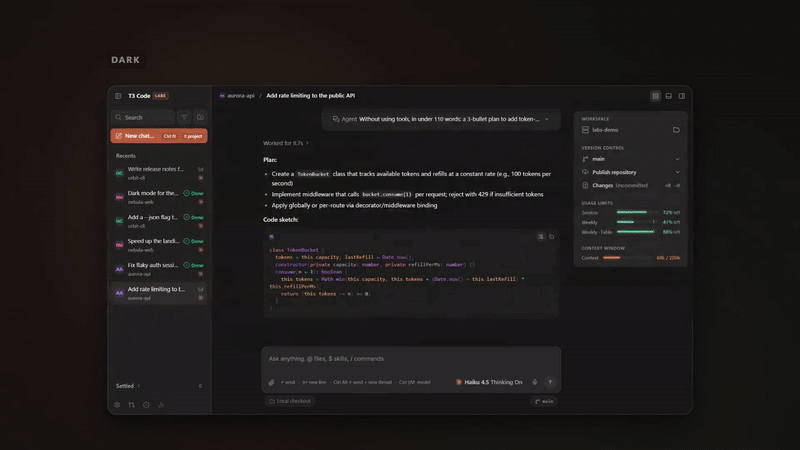
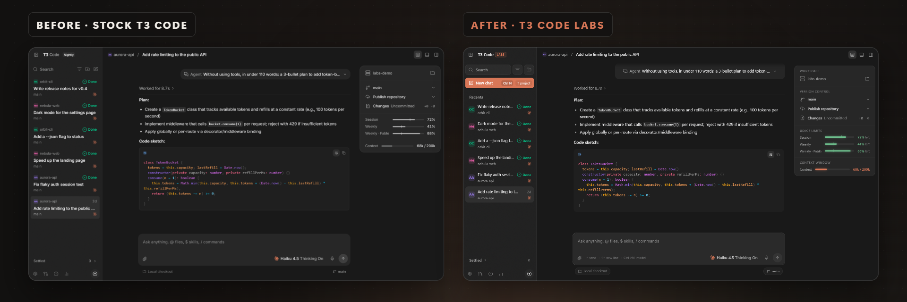
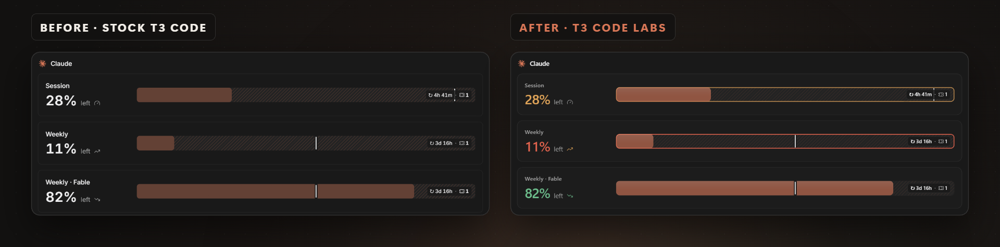

# T3 Code Labs

Um tema premium para o [T3 Code](https://github.com/pingdotgg/t3code), pensado para dar mais visibilidade ao uso e ao contexto. Um só ficheiro, sem fork.

[](https://github.com/brunobola-portfolio/t3-code-labs/releases/latest) [](LICENSE) [](https://github.com/pingdotgg/t3code)

[English](README.md)

[](media/t3-code-labs-film.mp4)

O T3 Code Labs mantém o nome T3 Code e acrescenta um pequeno selo **Labs**. Dá à app cores quentes em tom de barro, uma barra lateral e uma caixa de texto mais limpas, e indicadores de uso e de contexto com cores, para veres de relance quanto de cada limite e da janela de contexto uma conversa já gastou.

## O que muda

**Aspeto**
- Paletas escura e clara, quentes, com laranja de destaque.
- Cabeçalho "T3 Code" com o selo **Labs**.
- Menu na barra lateral: pesquisa, Projects, Add project e um botão grande **New chat** com o atalho (Ctrl+N).
- Conversas em duas linhas, título "Recents" e secções Working / Settled mais arrumadas.
- Seletor de modelos numa só coluna, com os níveis de esforço numa barra segmentada.
- Menus de contexto mais arredondados e suaves, com destaque laranja. O menu de seleção múltipla ganha ícones (Settle, Snooze, Regenerate titles, Mark unread, Delete) quando o T3 Code o desenha em HTML.

**Observabilidade**
- As barras de limite de uso no cartão de detalhes ficam **verdes** com folga, **âmbar** abaixo de 35% restante e **vermelhas** abaixo de 15%.
- A barra da janela de contexto passa a **âmbar** a partir de 65% usado e a **vermelho** a partir de 85%, para saberes quando a conversa está a ficar cheia.
- A página **Usage → Limits** (Ctrl+U) mostra um cartão por limite: o número fica verde, âmbar ou vermelho, a barra de uma conta que está a acabar ganha um anel âmbar ou vermelho (cada conta mantém a sua cor) e a indicação de ritmo fica âmbar quando gastas mais depressa do que a janela avança e verde quando tens folga.
- A caixa de texto ganha um brilho laranja suave enquanto escreves, e as indicações por baixo dela (pasta, branch, permissões) aparecem como etiquetas.

## Pré-visualização

| Indicadores de uso e contexto | Caixa de texto | Menus (web) |
| --- | --- | --- |
|  |  |  |

| Antes → depois | Escuro ↔ claro |
| --- | --- |
|  |  |

**Antes e depois** (T3 Code original à esquerda, T3 Code Labs à direita)



**Usage → Limits** (Ctrl+U), antes e depois



[Ver o filme de apresentação](media/t3-code-labs-film.mp4) (48 s, com som). Toda a interface que aparece é a web app real do T3 Code a correr numa instância de demonstração, montada em HTML; a música e os efeitos sonoros são sintetizados de raiz em cerca de 200 linhas de JavaScript. A [transição antes/depois](media/before-after.mp4) também existe como clip curto. Todos os media usam dados fictícios e podem ser gerados de novo com os scripts em [`media/src`](media/src/README.md).

## Instalar

**Com a linha de comandos do T3** (publica o tema e muda o T3 Code para ele):

```sh
curl -LO https://github.com/brunobola-portfolio/t3-code-labs/releases/latest/download/t3-code-labs.json
t3 theme set ./t3-code-labs.json
```

**Ou à mão:** descarrega o [`t3-code-labs.json`](https://github.com/brunobola-portfolio/t3-code-labs/releases/latest/download/t3-code-labs.json) da [última versão](https://github.com/brunobola-portfolio/t3-code-labs/releases/latest). No T3 Code abre **Settings → Appearance → Add theme**, arrasta o ficheiro (ou cola-o em **Theme JSON**) e escolhe **T3 Code Labs**.

Inclui modo escuro e claro.

### Definições recomendadas

O tema dá estilo a informação que o T3 Code já tem, mas parte dela vem desligada. Liga-a para teres o painel completo:

1. **Settings → Appearance → Thread details**: ativa **Usage limits** e **Context window**.
2. **Settings → Appearance → Advanced → Composer context**: ligado. Mantém o branch e a pasta de trabalho visíveis por baixo da caixa de texto depois de a conversa começar.

Para custos por modelo, tokens e poupança de cache, abre a página de uso do T3 Code com **Ctrl+U**.

## Requisitos e notas

- Precisa de uma versão do T3 Code cujos temas aceitem `css`. Foi testado na Nightly `0.1.10-nightly.20261116`; nightlies mais antigas só importam as cores.
- Na app de desktop, os menus de clique direito são menus nativos do sistema e um tema não os consegue alterar. Os ícones aparecem quando o T3 Code corre no browser.
- O aspeto interno do T3 Code pode mudar entre versões. O tema usa os seletores estáveis do T3 sempre que possível; se algo ficar estranho depois de uma atualização, [abre uma issue](https://github.com/brunobola-portfolio/t3-code-labs/issues).

## Gerar a partir do código

O `t3-code-labs.json` é gerado. Edita `scripts/build.py` (ou `src/base.json`) e corre:

```sh
python scripts/build.py
```

## Créditos

Baseado no [T3 Clawd](https://github.com/rohit3a/t3-clawd) de [@rohit3a](https://github.com/rohit3a) (MIT), cujo trabalho de layout é a base deste tema.

Não oficial. Sem ligação à T3 Tools Inc. O T3 Code é um produto da T3 Tools Inc.

## Licença

[MIT](LICENSE). Feito por [BolaLabs](https://github.com/BolaLabs).
